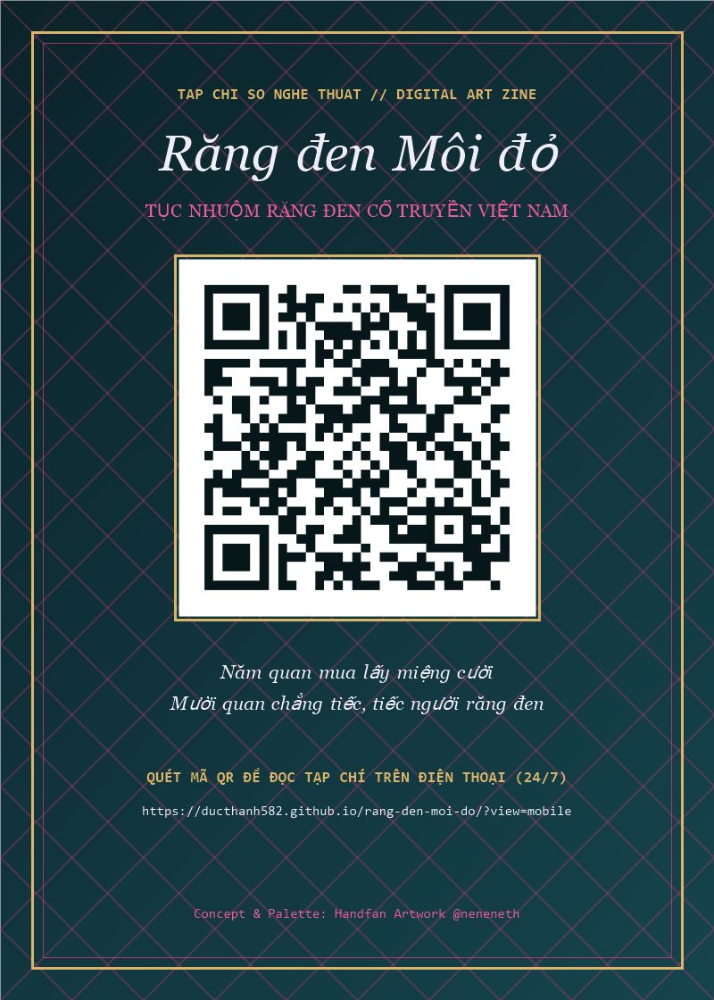

# Răng Đen Môi Đỏ — Tạp Chí Số Nghệ Thuật (Digital Art Zine)

Ấn phẩm web thông tin giới thiệu **Tục Nhuộm Răng Đen Cổ Truyền Việt Nam**, thiết kế theo phong cách tạp chí nghệ thuật đương đại (*Neo-Traditional Editorial Art Zine*), lấy cảm hứng và bảng màu từ tác phẩm Handfan **“Răng đen Môi đỏ”** (`@neneneth`).

## 🌐 Đường dẫn truy cập trực tuyến (Live 24/7)
- **Giao diện Web (Tạp chí Desktop):** [https://ducthanh582.github.io/rang-den-moi-do/](https://ducthanh582.github.io/rang-den-moi-do/)
- **Giao diện Điện thoại (Khi quét Mã QR):** [https://ducthanh582.github.io/rang-den-moi-do/?view=mobile](https://ducthanh582.github.io/rang-den-moi-do/?view=mobile)



## 🤝 Hướng dẫn cùng chỉnh sửa trên Antigravity
1. Clone dự án về máy:
   ```bash
   git clone https://github.com/ducthanh582/rang-den-moi-do.git
   ```
2. Mở thư mục `rang-den-moi-do` trong **Antigravity IDE** hoặc **Antigravity 2.0**.
   - Dự án đã tích hợp sẵn quy chuẩn AI tại `.agents/rules/project-style.md` để giữ đồng bộ bảng màu và bố cục tạp chí cho mọi thành viên.
3. Chạy thử dưới máy cá nhân:
   ```bash
   python -m http.server 5588
   ```
   Sau đó mở `http://localhost:5588`.
4. Sau khi chỉnh sửa xong, lưu và đẩy thay đổi lên GitHub:
   ```bash
   git add .
   git commit -m "Cap nhat noi dung"
   git push
   ```
